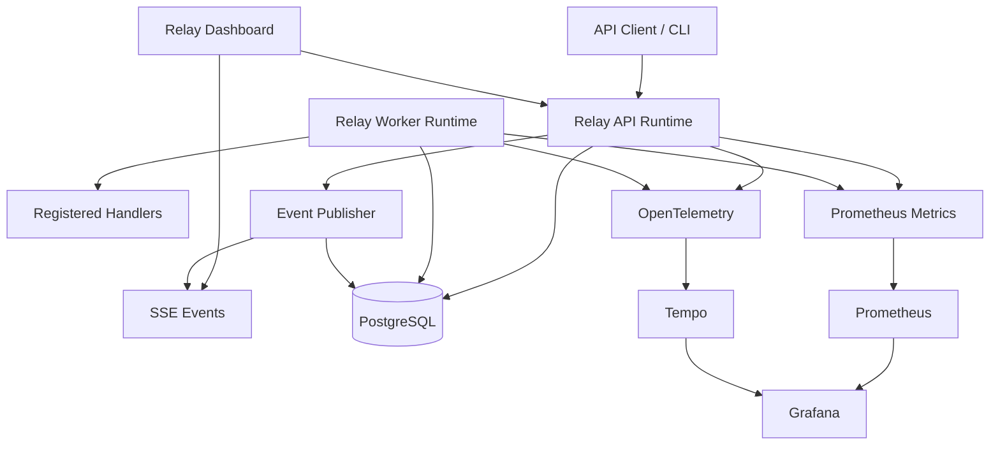
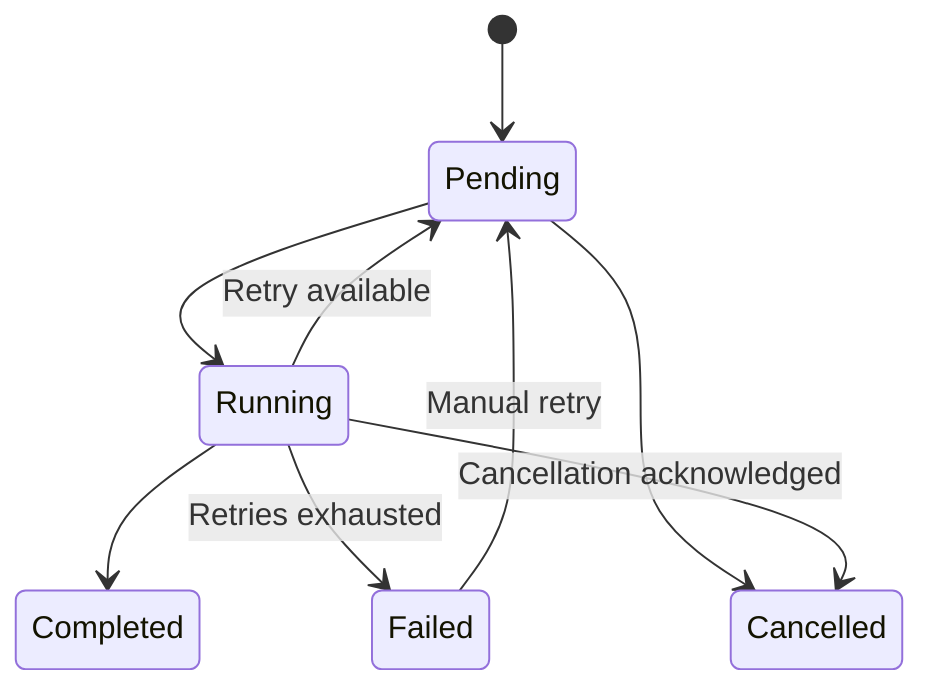

# Relay Technical Design Document (TDD)

**Status:** Draft for review  
**Version:** 0.1  
**Scope:** MVP architecture and implementation plan

---

## 1. Purpose and design principles

Relay is a self-hosted background-job processing and orchestration platform. It accepts jobs through an API, persists them, schedules and dispatches them to registered handlers, tracks execution, retries recoverable failures, and exposes operational information.

Relay is infrastructure, not business logic. Application developers provide handlers; Relay manages their execution lifecycle.

### Design principles

- **Durability first:** PostgreSQL is the source of truth for jobs, attempts, coordination, and recovery.
- **At-least-once execution:** jobs may execute more than once. Handlers should be idempotent when possible.
- **Explicit state:** lifecycle transitions are validated and observable.
- **Small, understandable MVP:** avoid unnecessary services and abstractions.
- **Self-hosted and local-first:** no mandatory cloud service or paid dependency.
- **API-first:** the backend is usable without the official dashboard.
- **Separation of concerns:** backend orchestration, frontend dashboard, and infrastructure are separate applications.
- **Operational transparency:** metrics, structured logs, tracing, and attempt history are part of the initial implementation.
- **Failure-aware:** recover from process crashes, stale workers, transient failures, and shutdowns without pretending arbitrary external side effects can be rolled back.

---

## 2. System architecture

Relay is a modular monolith with distinct runtime modes. The API and worker are logical and operational boundaries, not necessarily separate codebases or binaries.

### 2.1 Components

#### Relay Backend

The Go application contains:

- REST API
- Job and queue domain services
- PostgreSQL persistence layer
- Job claiming and execution coordination
- Scheduler and recovery mechanisms
- Worker runtime and handler registry
- Cancellation and retry logic
- SSE event publisher
- Metrics and tracing instrumentation

#### Relay Dashboard

A separate React + TypeScript application.

- Communicates exclusively with the backend's public REST API and SSE endpoint.
- Is optional; Relay can be operated through its API or CLI without it.
- Does not contain orchestration, scheduling, retry, or worker logic.
- Is independently built, configured, and deployed.

#### PostgreSQL

The durable system of record:

- Jobs
- Job attempts
- Queue metadata and configuration
- Worker registrations and heartbeat/lease information, as needed
- Coordination and recovery state

PostgreSQL is also the initial coordination mechanism between API and worker runtimes.

#### Observability stack

- Prometheus: metrics collection
- Grafana: dashboards and visualization
- OpenTelemetry: instrumentation and trace export
- Tempo: proposed trace storage backend for local Compose setup

The observability stack is optional to core processing. Relay must still function when the visualization stack is unavailable.

### 2.2 Architecture overview



### 2.3 Runtime modes

Relay supports three modes:

1. **Combined:** `relay start` runs API and worker runtimes in one process. Intended for local development and simple deployments.
2. **API-only:** `relay api`. Handles requests, persistence, and API-facing operations.
3. **Worker-only:** `relay worker --queues=default,reports --concurrency=4`. Processes selected queues.

The API and workers can scale independently. Multiple workers coordinate through PostgreSQL. Multiple API instances may be deployed, provided the database and event-distribution mechanism are shared.

### 2.4 Repository layout

The applications remain separate within the repository:

```text
relay/
├── relay-backend/
│   ├── cmd/
│   ├── internal/
│   │   ├── api/
│   │   ├── config/
│   │   ├── domain/
│   │   ├── events/
│   │   ├── handlers/
│   │   ├── jobs/
│   │   ├── observability/
│   │   ├── persistence/
│   │   ├── queues/
│   │   ├── scheduler/
│   │   └── workers/
│   ├── migrations/
│   ├── Dockerfile
│   └── go.mod
├── relay-dashboard/
│   ├── src/
│   ├── public/
│   ├── Dockerfile
│   └── package.json
└── relay-infrastructure/
    ├── docker-compose.yml
    ├── prometheus/
    └── grafana/
```

The precise package boundaries may evolve during implementation, but domain logic must not depend on HTTP or dashboard concerns.

---

## 3. Technology stack

### 3.1 Backend

| Concern | Choice |
|---|---|
| Language | Go |
| HTTP router | chi |
| PostgreSQL driver | pgx / pgxpool |
| SQL | Handwritten SQL |
| ORM | None |
| Migrations | Goose |
| Logging | `log/slog`, structured JSON |
| CLI | Cobra |
| API contract | OpenAPI |
| Metrics | Prometheus |
| Tracing | OpenTelemetry |

### 3.2 Dashboard

| Concern | Choice |
|---|---|
| Framework | React |
| Language | TypeScript, strict mode |
| Build | Vite |
| Styling | Tailwind CSS |
| UI components | shadcn/ui |
| Routing | React Router |
| Server state | TanStack Query |
| Local UI state | React state |
| Charts | Recharts |
| API typing/client | Generated from OpenAPI |
| Live updates | Server-Sent Events (SSE) |

### 3.3 Testing and quality

- Go standard `testing` package
- Testify, used selectively for assertions
- testcontainers-go for PostgreSQL integration tests
- Go race detector
- Vitest
- React Testing Library
- Playwright
- ESLint
- Prettier
- Strict TypeScript

### 3.4 Local infrastructure

- Docker Compose
- PostgreSQL
- Prometheus
- Grafana
- Tempo (proposed)

Backend and dashboard run natively during local development where convenient; supporting infrastructure runs in Docker.

---

## 4. Domain model

### 4.1 Job

A Job represents a unit of work submitted to Relay.

Proposed fields:

| Field | Type / meaning |
|---|---|
| `id` | UUID; unique identifier |
| `name` | Optional human-readable name |
| `handler` | Required stable handler identifier |
| `payload` | JSONB input |
| `queue` | Queue name |
| `status` | Current lifecycle state |
| `priority` | Integer 0–100; default 50 |
| `scheduled_at` | Earliest time at which it may be claimed; default immediate |
| `max_attempts` | Maximum automatic execution attempts |
| `timeout_seconds` | Optional execution timeout |
| `created_at` | Creation timestamp |
| `updated_at` | Last update timestamp |
| `completed_at` | Terminal completion timestamp, when applicable |
| `last_error` | Optional summarized error from the latest unsuccessful execution |

Additional internal fields required for coordination, cancellation, and recovery are specified in the processing and database sections.

`payload` is JSONB. Relay treats it as opaque input and does not interpret application-specific semantics. Payload size is bounded by configurable or documented limits.

### 4.2 JobAttempt

A JobAttempt records one concrete execution attempt. Attempt records are immutable in identity and history; execution-related fields are updated while the attempt is active and finalized when it ends.

Proposed fields:

| Field | Meaning |
|---|---|
| `id` | UUID |
| `job_id` | Parent job |
| `attempt_number` | Monotonically increasing number for this job |
| `worker_id` | Worker that performed the attempt |
| `status` | Attempt result/state |
| `started_at` | Start timestamp |
| `finished_at` | Finish timestamp |
| `error` | Error summary, if any |
| `result` | Optional JSON result, bounded in size |
| `execution_duration` | Derived from timestamps or stored if needed |

Each execution produces a distinct attempt. Previous attempts are never overwritten when a job retries or is manually restarted.

Attempt outcomes include:

- `Running`
- `Completed`
- `Failed`
- `Cancelled`
- `TimedOut`
- `Lost`

These outcomes distinguish intentional cancellation, timeout, normal failure, and recovery from an execution whose worker disappeared. The precise mapping between job status and attempt outcome is defined below.

### 4.3 Queue

A Queue is a logical routing and execution-priority boundary.

- Jobs belong to one queue.
- Workers subscribe to one or more queues.
- Queue configuration may include enabled/disabled state and future policy settings.
- A default queue exists.
- Queue names are validated and normalized.

Queue and Handler are distinct: a queue determines where a job waits and which workers may claim it; a handler determines which registered code executes it.

### 4.4 Worker

A Worker represents a running worker process or logical worker instance.

Worker information includes:

- Worker ID
- Process/instance identity
- Registered queues
- Configured concurrency
- Current activity, where available
- Last heartbeat
- Started timestamp
- Version/build information, if available

Worker metadata is primarily operational and must not be treated as a perfect record of process liveness. Heartbeat and lease mechanisms determine whether an owner is considered alive.

### 4.5 Handler

A Handler is user-provided code registered under a stable identifier.

Handlers are not persisted as executable code in Relay. Relay stores the handler identifier and payload, then dispatches the job to a matching handler in the worker's registry.

---

## 5. Job lifecycle and state machine

### 5.1 Job statuses

- `Pending`: waiting to be claimed; may be scheduled for the future.
- `Running`: currently owned and being executed by a worker.
- `Completed`: successfully completed.
- `Failed`: automatic attempts exhausted or otherwise finalized as failed.
- `Cancelled`: cancellation successfully finalized.

### 5.2 State transitions



Transitions must be validated by the backend. Clients may request actions, but must not directly set arbitrary job statuses.

### 5.3 Scheduling and state

Scheduling is represented by `scheduled_at`, not by a separate `Scheduled` status.

- A job is `Pending` until claimed or cancelled.
- A future `scheduled_at` makes it ineligible for claiming until due.
- A missing `scheduled_at` means immediate eligibility.
- A past `scheduled_at` means it is eligible, subject to other conditions.

### 5.4 Manual retry

A `Failed` job can be manually retried.

- The job returns to `Pending`.
- A new attempt is created when execution begins.
- Previous attempt history remains intact.
- Manual retry is an explicit action and must be recorded for auditability.
- Manual retry should reset or override the exhausted automatic retry state in a controlled manner, without erasing history.

The API must prevent concurrent or invalid manual retry requests from creating duplicate execution cycles.

---

## 6. Database design

### 6.1 PostgreSQL as source of truth

All durable lifecycle and coordination decisions are grounded in PostgreSQL. In-memory state is used only for runtime coordination and must not be the sole source of truth for job ownership or completion.

### 6.2 Proposed tables

#### `jobs`

Contains the Job fields and execution coordination metadata, such as:

- Current status
- Queue
- Priority
- Scheduled time
- Attempt counters and retry configuration
- Current ownership/lease fields
- Cancellation request marker
- Timestamps
- Last error summary

#### `job_attempts`

Contains the durable history of individual attempts.

- Unique constraint on `(job_id, attempt_number)`
- Foreign key to `jobs`
- Attempt start and finish timestamps
- Attempt outcome
- Worker identifier
- Error and bounded result data

#### `queues`

Contains queue configuration and metadata. MVP configuration should remain intentionally small.

#### `workers` (or equivalent worker registry)

Stores worker identity and operational heartbeat information as needed for visibility and recovery. Worker records should not be assumed to represent permanently live processes.

#### `job_events` (proposed)

A durable event/audit history for important actions and transitions, such as:

- Job created
- Attempt started
- Attempt completed/failed/cancelled/lost
- Retry scheduled
- Manual retry requested
- Cancellation requested
- Job state changed

This table supports history, auditability, and recovery diagnostics. It is not a replacement for the current state in `jobs` or attempt records.

### 6.3 Claiming jobs safely

The job-claiming mechanism must prevent two workers from simultaneously acquiring the same job.

Use PostgreSQL transactions and row locking, with `FOR UPDATE SKIP LOCKED` as the primary candidate-selection technique.

A claim operation should atomically:

1. Select an eligible Pending job from the worker's subscribed queues.
2. Respect scheduled time, priority, and cancellation state.
3. Lock the candidate row so concurrent workers skip it.
4. Transition the job to Running.
5. Assign ownership and a lease.
6. Create the corresponding JobAttempt.
7. Commit.

The transaction must be short. Handler execution must never occur inside the claim transaction.

### 6.4 Indexing

Initial indexes should support:

- Claiming Pending jobs by queue, scheduled time, priority, and creation order.
- Looking up jobs by ID.
- Filtering jobs by status and queue.
- Listing attempts by job and attempt number.
- Finding stale leases.
- Event history by job and timestamp.

Index design will be validated against actual query plans and realistic data. Avoid unnecessary indexes on write-heavy tables.

### 6.5 Data retention

MVP should retain job and attempt history by default. A later configurable retention/archival mechanism may be added. Deletion or pruning must not silently remove recent failure history or active jobs.

---

## 7. Job processing engine

### 7.1 Worker execution loop

Each worker runtime:

1. Starts and validates configuration.
2. Connects to PostgreSQL.
3. Registers/updates worker identity.
4. Starts heartbeat and lease maintenance.
5. Runs a bounded number of execution slots.
6. Claims eligible jobs for subscribed queues.
7. Dispatches claimed jobs to registered handlers.
8. Persists attempt outcome and job state.
9. Repeats until shutdown.

Workers use bounded concurrency. Concurrency is configured per worker process and must not exceed the configured execution-slot count.

### 7.2 Job claiming and ownership

Claiming is transactional. The worker receives a lease for the job rather than relying only on an in-memory ownership flag.

Ownership metadata should include:

- Worker identifier
- Lease expiration timestamp
- Heartbeat/renewal information
- Optional claim token or generation value to protect against stale owners

The claim token or equivalent fencing mechanism should be checked when a worker finalizes an attempt, so an old or recovered worker cannot overwrite newer ownership or state.

### 7.3 Handler interface

The initial handler contract should be simple and idiomatic Go:

```go
type Handler interface {
    Handle(ctx context.Context, payload json.RawMessage) (json.RawMessage, error)
}
```

A function adapter may be provided for convenience.

- Handler identifiers are registered at worker startup.
- Duplicate registration is rejected.
- Missing handler identifiers produce a clear execution error.
- Payload decoding/validation is the responsibility of the handler or an optional helper layer.
- Handlers receive a context containing cancellation and timeout signals.
- Relay does not dynamically execute arbitrary code, shell commands, or user-uploaded binaries.

### 7.4 Handler execution

Handlers execute outside database transactions.

Relay controls lifecycle and context cancellation; handlers perform application-specific work. Handler developers should use context-aware APIs and implement idempotency when possible.

Relay cannot guarantee that a handler's external side effects are rolled back when execution fails, times out, or is cancelled.

### 7.5 Worker concurrency

- Concurrency is bounded per worker process.
- Queue subscriptions are explicit.
- Workers may subscribe to multiple queues.
- Worker processes can be scaled independently.
- The system must not claim more jobs than it has execution capacity for, except where a deliberate bounded prefetch strategy is implemented.

A simple one-job-per-available-slot claim strategy is the initial design.

---

## 8. Reliability, retries, timeouts, cancellation, and recovery

### 8.1 Delivery guarantees

Relay provides **at-least-once execution**, not exactly-once execution.

A worker may execute a handler and crash before Relay durably records completion. Recovery may cause the job to run again.

Handlers should be idempotent or use application-level deduplication when external side effects must not be duplicated.

### 8.2 Retry policy

When a handler returns a recoverable error:

- The attempt is marked Failed.
- If automatic attempts remain, the job returns to Pending.
- `scheduled_at` is updated to the next retry time.
- Retry delay is computed using exponential backoff with jitter.
- The retry policy is bounded by `max_attempts`.

Proposed default retry policy:

- Configurable maximum attempts.
- Exponential backoff.
- Random jitter to avoid synchronized retry storms.
- A configurable maximum retry delay.
- No retry for a successfully completed or cancelled job.
- A job becomes Failed when its automatic retry budget is exhausted.

Initial values should be sensible and documented, but adjustable through job or system configuration as appropriate. The implementation should avoid exposing an unnecessarily complex policy surface in the MVP.

### 8.3 Error classification

Handlers return errors. Relay initially treats handler errors as retryable unless the handler or an optional error type indicates that the error is non-retryable.

Proposed minimal classification:

- Retryable error: retry according to policy.
- Non-retryable error: end automatic retries and mark job Failed.
- Cancellation: mark the attempt Cancelled if cancellation was acknowledged.
- Timeout: mark attempt TimedOut; retry if policy allows.
- Lost execution: recovery finalizes or reconciles the attempt as Lost and makes the job eligible for recovery according to policy.

Error classification must be explicit and documented; avoid parsing error strings to determine behavior.

### 8.4 Timeouts

Jobs may specify an execution timeout. A configured timeout is enforced by a Go context deadline.

- Timeout cancellation is cooperative.
- A context-aware handler may stop promptly.
- Relay cannot safely kill arbitrary goroutines.
- If the handler does not cooperate, the worker may remain occupied.
- Process-level recovery may be necessary in extreme cases; killing a process does not undo external side effects.

A timeout is an execution outcome distinct from an ordinary handler error. Timeout retry behavior follows the configured retry policy.

### 8.5 Cancellation

#### Pending job

A Pending job can be cancelled immediately through an atomic database state transition to Cancelled.

#### Running job

- Cancellation is persisted as a request/marker.
- Relay signals the execution context.
- The handler is expected to stop cooperatively.
- If cancellation is acknowledged, the attempt is finalized as Cancelled and the Job becomes Cancelled.
- Cancellation is observable and recorded in job history.

A cancellation request racing with successful completion must be resolved atomically. The system should not retroactively mark a successfully completed job as cancelled. The finalization transaction determines the winning state transition.

A configurable cancellation grace period may be used to detect handlers that fail to stop. Grace-period expiry does not imply that a Go goroutine can be forcibly terminated. The worker can be marked unhealthy and operator intervention or process recovery may be required.

### 8.6 Lease and heartbeat

Workers renew leases while executing jobs.

- Lease renewal is independent of handler progress.
- Lease duration and heartbeat interval must be configurable.
- The heartbeat interval should be substantially shorter than the lease duration.
- A worker that stops renewing is considered potentially lost once its lease expires.
- Recovery must be designed to tolerate temporary database/network outages and avoid false recovery decisions.

### 8.7 Recovery of stale jobs

A recovery process identifies Running jobs whose lease has expired.

Recovery must reconcile job and attempt records transactionally:

1. Verify that the job is still Running and its lease is expired.
2. Verify that the recovery action is not acting on a renewed lease.
3. Mark the previous attempt Lost (or otherwise record the lost execution distinctly).
4. Clear or replace ownership.
5. Decide whether to retry or finalize as Failed according to retry policy.
6. Record the recovery event.
7. Commit.

A recovered job may execute again, even if the previous worker was still performing an external side effect. This is part of the at-least-once contract.

### 8.8 Shutdown

Worker shutdown is graceful where possible:

1. Stop claiming new jobs.
2. Signal running jobs according to the shutdown policy.
3. Wait for a bounded grace period for handlers to finish.
4. Persist outcomes where possible.
5. Release or allow leases to expire for work that cannot safely be finalized.
6. Exit.

The API runtime also handles shutdown by stopping acceptance of new requests and allowing in-flight requests to complete within a bounded period.

---

## 9. Scheduling and queue policies

### 9.1 Scheduling

`scheduled_at` controls earliest eligibility.

- Immediate jobs use the current time or equivalent immediate eligibility.
- Future jobs remain Pending.
- Workers claim only jobs whose scheduled time is due.
- Retry delay updates scheduling eligibility.

A scheduler/recovery component performs periodic maintenance, including recovery checks and any time-dependent operations not handled directly by claim queries.

### 9.2 Priority and ordering

Priority is a numeric value in the range **0–100**, with 50 as the default.

- Higher values are preferred.
- Equal-priority jobs are ordered FIFO using creation time and a stable tie-breaker.
- Priority ordering is strict for the MVP.
- Priority aging is not implemented initially.

Strict priority can starve lower-priority jobs if higher-priority work continuously arrives. This trade-off is accepted for the MVP and should be documented.

### 9.3 Queue selection

- Queue is a logical routing boundary.
- Workers explicitly subscribe to queue names.
- A worker may subscribe to multiple queues.
- Queue selection and priority ordering occur during job claiming.
- Queue-level advanced policies (rate limiting, fairness, quotas, weighted scheduling) are out of MVP scope.

---

## 10. REST API design

### 10.1 API principles

- Versioned API under `/api/v1`.
- JSON request and response bodies.
- Consistent error envelope.
- Validation at API boundary.
- OpenAPI contract.
- Clients do not directly manipulate arbitrary job statuses.
- Pagination for list endpoints.
- Filtering and sorting are explicitly supported rather than relying on unbounded queries.

### 10.2 Proposed endpoints

#### Jobs

| Method | Endpoint | Purpose |
|---|---|---|
| `POST` | `/api/v1/jobs` | Create a job |
| `GET` | `/api/v1/jobs` | List/filter jobs |
| `GET` | `/api/v1/jobs/{id}` | Get job details |
| `GET` | `/api/v1/jobs/{id}/attempts` | List attempt history |
| `POST` | `/api/v1/jobs/{id}/cancel` | Request cancellation |
| `POST` | `/api/v1/jobs/{id}/retry` | Manually retry a Failed job |

#### Queues

| Method | Endpoint | Purpose |
|---|---|---|
| `GET` | `/api/v1/queues` | List queues and basic statistics |
| `GET` | `/api/v1/queues/{name}` | Get queue details |

Queue mutation/configuration endpoints may be added when the MVP configuration requirements are finalized.

#### Workers

| Method | Endpoint | Purpose |
|---|---|---|
| `GET` | `/api/v1/workers` | List worker instances |
| `GET` | `/api/v1/workers/{id}` | Get worker details |

#### Events

| Method | Endpoint | Purpose |
|---|---|---|
| `GET` | `/api/v1/events` | Subscribe to SSE updates |

#### Health and metrics

| Method | Endpoint | Purpose |
|---|---|---|
| `GET` | `/health` | Basic process health |
| `GET` | `/ready` | Readiness check |
| `GET` | `/metrics` | Prometheus metrics |

### 10.3 Job creation

A create request may include:

- Handler identifier
- Payload
- Queue (default if omitted)
- Name (optional)
- Priority (default 50)
- Scheduled time (optional)
- Retry/timeout overrides (if supported)

The API validates the request, persists the job, and returns the created job. It does not execute the handler inline.

### 10.4 Errors

Errors use a consistent response shape containing a stable error code, human-readable message, and optional structured details. Internal stack traces, database details, and sensitive information are not returned to clients.

### 10.5 Pagination

Job and attempt listing endpoints use bounded pagination. The API should support filtering by status, queue, handler, and time ranges where appropriate. Pagination strategy and maximum page size are documented.

### 10.6 OpenAPI

OpenAPI is the source contract for the dashboard client and generated types. Changes to API schemas should be validated and reflected in the generated dashboard client.

---

## 11. Event delivery and SSE

### 11.1 Purpose

SSE provides transient live updates for the dashboard, such as job state changes, worker heartbeats/status, and queue updates.

REST remains the source of truth. Event delivery is not a durable consumer protocol.

### 11.2 Event types

Initial event types may include:

- `job.created`
- `job.updated`
- `job.attempt.started`
- `job.attempt.completed`
- `job.attempt.failed`
- `job.attempt.cancelled`
- `worker.updated`
- `queue.updated`

Events should carry enough information to identify the entity and update or invalidate client-side cache entries, without unnecessarily transmitting large payloads.

### 11.3 Delivery model

- Events are transient.
- Clients may disconnect or miss events.
- The dashboard reconciles state by refetching REST data.
- Event IDs may support basic reconnect behavior, but SSE is not a guarantee of complete event history.
- Durable job history is available through REST and database-backed records.

### 11.4 Multiple API instances

A single API instance can publish to its connected SSE clients in memory.

For multiple API instances, event distribution must be shared. The proposed MVP mechanism is PostgreSQL `LISTEN/NOTIFY`, with an in-process fanout layer per API instance. Notifications are transient and payloads should remain small; the publisher emits identifiers or compact event envelopes rather than full job payloads.

PostgreSQL state remains authoritative. Notification loss or subscriber restart must not corrupt job state.

---

## 12. Handler system

### 12.1 Registration

Handlers are registered by identifier at worker startup.

- Registration is explicit.
- Identifier names are stable and documented.
- Duplicate names fail startup.
- Workers must not claim jobs for handlers they cannot execute, where handler-aware routing is enabled.
- A missing handler is a clearly classified execution failure, not a silent discard.

### 12.2 Payloads

Payloads are JSON. Relay stores and transports them but does not own application-specific schemas.

Handlers are responsible for decoding, validation, and application logic. Optional helper utilities may simplify decoding but should not impose a schema framework on the MVP.

### 12.3 Idempotency

Relay does not provide exactly-once side-effect semantics.

Handler authors should:

- Use idempotency keys where applicable.
- Avoid assuming an attempt will execute only once.
- Make external side effects safe to repeat where possible.
- Use transactional patterns in their own systems where appropriate.

---

## 13. Observability

Observability is part of the MVP.

### 13.1 Structured logging

Use Go `log/slog` with structured JSON output.

Logs should include useful context where applicable:

- Job ID
- Attempt ID
- Worker ID
- Queue
- Handler identifier
- Event/action
- Error classification

Avoid logging full payloads, secrets, credentials, or sensitive data by default.

### 13.2 Metrics

Prometheus metrics include:

- `relay_jobs_total` (created jobs, with bounded labels)
- `relay_jobs_pending` (pending jobs, preferably queue-aware where cardinality is controlled)
- `relay_jobs_running`
- `relay_jobs_failed_total`
- `relay_jobs_completed_total`
- `relay_job_execution_duration_seconds`
- `relay_job_attempts_total`
- `relay_worker_active_count`
- `relay_worker_concurrency`
- `relay_queue_depth`
- `relay_job_recovery_total`
- `relay_job_retry_total`

Metric labels must avoid high-cardinality values such as job IDs, attempt IDs, arbitrary payload values, or unbounded customer input.

### 13.3 Tracing

OpenTelemetry instrumentation should cover:

- HTTP requests
- Job lifecycle operations
- Job claiming
- Handler execution
- Retry and recovery operations
- Database calls, where supported

Trace context may be propagated from API request to job execution where useful. Job payloads should not be used as trace attributes.

### 13.4 Dashboarding

Grafana dashboards should cover:

- Queue depth and backlog
- Job throughput
- Job completion/failure rates
- Retry and recovery activity
- Execution duration distributions
- Worker utilization and health
- API health and latency

### 13.5 Health checks

- `/health`: process-level health.
- `/ready`: checks readiness to perform its role, including required dependencies where appropriate.

Health endpoints should distinguish process liveness from readiness.

---

## 14. Dashboard architecture and UX

### 14.1 Architecture

Relay Dashboard is an independent React application.

- Uses generated API client/types from OpenAPI.
- TanStack Query manages server state.
- React state handles local UI state.
- SSE updates invalidate or update query cache.
- Dashboard contains no job orchestration logic.
- Dashboard is independently deployable.

### 14.2 Initial pages

- **Overview:** system summary, backlog, throughput, failures, worker activity.
- **Jobs:** searchable/filterable job table, status, queue, handler, timestamps.
- **Job detail:** payload (with appropriate privacy caution), lifecycle, attempts, errors, cancellation/retry actions.
- **Queues:** queue depth and basic configuration/status.
- **Workers:** worker list, queue subscriptions, concurrency, activity and health.
- **Metrics/Observability:** charts and operational summaries, with links or references to Grafana where appropriate.

### 14.3 UI principles

- Dark-first interface.
- Restrained teal/cyan accent, neutral surfaces, semantic status colors.
- Clean tables and readable information density.
- Responsive layout and accessibility.
- Avoid unnecessary decoration.
- Clear distinction between current state and historical attempt details.
- Destructive or disruptive actions (cancel, manual retry) require clear confirmation and feedback.

---

## 15. Security and configuration

### 15.1 Security boundaries

Relay is intended to be self-hosted. Self-hosted does not automatically mean safe to expose to the internet.

The MVP should:

- Provide a configurable authentication mechanism for API access, preferably a bearer token or API key suitable for a single-operator deployment.
- Avoid exposing credentials in logs.
- Validate request bodies and bound payload sizes.
- Apply reasonable limits to list endpoints and request rates where practical.
- Document that deployments exposed beyond a trusted local network require authentication and appropriate transport security.
- Avoid executing arbitrary code or shell commands supplied through the API.
- Keep database credentials and tokens in environment variables or secrets mechanisms.

Dashboard authentication and browser token handling must be reviewed carefully before exposing the dashboard publicly. Avoid hardcoding long-lived secrets into frontend builds.

### 15.2 Configuration

Environment variables are the primary configuration source. An optional `.env` file is supported for local development.

Configuration:

- Uses a documented `RELAY_` prefix.
- Is validated at startup.
- Does not require YAML/JSON configuration files for the MVP.
- Has documented defaults and examples.
- Separates API and worker role-specific settings where necessary.

Representative configuration categories:

- Database connection
- HTTP listen address
- API authentication
- Worker queues
- Worker concurrency
- Heartbeat and lease durations
- Execution timeout defaults
- Retry defaults
- Graceful shutdown duration
- Observability exporters
- Payload and request limits

---

## 16. Testing strategy

### 16.1 Unit tests

Use Go `testing` and Testify selectively.

Test:

- State transition rules
- Retry calculations
- Priority validation and ordering
- Configuration validation
- Error classification
- Cancellation behavior
- Handler registration
- API request validation

### 16.2 Integration tests

Use testcontainers-go with real PostgreSQL.

Test:

- Migrations
- Job creation and retrieval
- Claim transactions
- Concurrent claiming
- Retry persistence
- Attempt history
- Cancellation
- Lease renewal and expiration
- Recovery transactions
- API/database behavior

### 16.3 Concurrency and race tests

Concurrency correctness is a core requirement.

Test:

- Two workers cannot claim the same job concurrently.
- Multiple claimers safely select distinct jobs.
- Cancellation racing with completion resolves consistently.
- Recovery racing with lease renewal does not incorrectly recover a live job.
- A stale owner cannot finalize a newer execution.
- Parallel status changes do not violate state invariants.

Use Go's race detector (`go test -race`) for race-prone code.

### 16.4 End-to-end tests

Exercise the full system with PostgreSQL and backend runtimes:

- Submit a job through REST.
- Verify worker claims it.
- Verify successful completion and attempt history.
- Verify handler failure and retry.
- Verify retry exhaustion and manual retry.
- Verify cancellation.
- Verify scheduling.
- Verify worker-loss recovery.
- Verify SSE event delivery and dashboard reconciliation.

### 16.5 Dashboard tests

- Vitest for logic and unit tests.
- React Testing Library for component/integration tests.
- Playwright for end-to-end browser tests.

Test key user flows, filtering, job details, attempt history, cancel/retry actions, and live-update reconciliation.

---

## 17. Local development and deployment

### 17.1 Local development

- PostgreSQL and observability services run in Docker.
- Go backend runs natively on the developer machine.
- React dashboard runs natively.
- API and worker can be started in combined or separate mode.
- Database migrations run through the backend CLI or Makefile task.

### 17.2 Docker Compose

Compose is the initial deployment and integration environment.

Services may include:

- PostgreSQL
- Relay API (or combined mode)
- Relay Worker
- Relay Dashboard
- Prometheus
- Grafana
- Tempo

The API and worker may use separate containers in production-like setups. Dashboard, API, and database are separately configured.

### 17.3 Docker images

- Backend image.
- Dashboard image.
- Infrastructure configuration.

Images should be reproducible and reasonably small. Backend should use a multi-stage build and a non-root runtime where practical.

### 17.4 Makefile

Common commands:

```makefile
dev:
test:
test-integration:
lint:
build:
migrate-up:
migrate-down:
infra-up:
infra-down:
```

Make targets are convenience wrappers; the underlying commands should remain usable independently.

### 17.5 Deployment scope

MVP deployment target is Docker Compose or equivalent self-hosted deployment. Kubernetes, cloud-specific managed dependencies, and complex deployment orchestration are out of scope.

---

## 18. Engineering standards

### Backend

- Idiomatic Go.
- Explicit error handling.
- Avoid unnecessary abstraction and dependency proliferation.
- Context propagation for I/O and cancellation.
- Short database transactions.
- No handler execution inside claim transactions.
- Concurrency invariants documented and tested.
- Stable API contract and OpenAPI specification.
- SQL migrations are reviewed and versioned.

### Frontend

- TypeScript strict mode.
- Generated API types.
- Server state through TanStack Query.
- Local UI state kept local unless shared state genuinely warrants it.
- Accessible components and keyboard navigation.
- Consistent formatting and linting.

### General

- No secrets in source code.
- No sensitive payloads in logs or metrics.
- Document significant design decisions.
- Prefer correctness and observability over premature optimization.

---

## 19. MVP scope and exclusions

### Included

- REST API
- Durable job persistence
- Queues
- Registered handlers
- Worker runtime
- Combined/API-only/worker-only modes
- Bounded concurrency
- Priority
- Scheduling
- Retry and backoff
- Timeouts
- Cancellation
- Lease and heartbeat
- Stale-worker recovery
- Manual retry
- Job attempt history
- Dashboard
- SSE
- Prometheus metrics
- OpenTelemetry tracing
- Structured logging
- Docker Compose
- Integration, concurrency, and E2E tests

### Excluded initially

- Exactly-once execution guarantee
- Complex workflow/DAG orchestration
- Arbitrary shell execution
- Dynamic execution of uploaded code
- Kubernetes
- Mandatory cloud services
- Redis
- Advanced queue fairness, priority aging, rate limiting, and quotas
- Distributed scheduler requiring a separate external service
- Multi-tenant authorization and elaborate role-based access control
- Sophisticated archival and retention policies
- Complex plugin ecosystem

---

## 20. Implementation roadmap

The roadmap is a suggested implementation order, not a requirement to complete each phase in isolation.

### Phase 1 — Foundation

- Repository layout
- Go CLI and configuration
- PostgreSQL connectivity
- Migration tooling
- Logging
- Health checks
- Docker Compose infrastructure

### Phase 2 — Domain and API

- Job domain model
- State transition rules
- Job persistence
- Create/list/detail API
- OpenAPI specification
- Basic API tests

### Phase 3 — Worker engine

- Handler registry
- Claiming transactions
- Worker execution loop
- JobAttempt persistence
- Worker concurrency
- Combined and separate runtime modes

### Phase 4 — Reliability

- Retry policy and backoff
- Timeout handling
- Cancellation
- Lease and heartbeat
- Recovery
- Manual retry
- Concurrency and recovery integration tests

### Phase 5 — Scheduling and queue policy

- Scheduled jobs
- Priority ordering
- Queue subscriptions
- Queue statistics

### Phase 6 — Observability and live events

- Prometheus metrics
- OpenTelemetry instrumentation
- Grafana dashboards
- SSE
- PostgreSQL notification-based event fanout

### Phase 7 — Dashboard

- Overview
- Jobs list and filtering
- Job detail and attempts
- Cancel and retry actions
- Queues
- Workers
- Live updates

### Phase 8 — Hardening

- E2E tests
- Load and concurrency testing
- API/security review
- Documentation
- Docker image hardening
- MVP acceptance review

---

## 21. Decisions requiring review / risks

This draft intentionally makes decisions to keep implementation moving. These areas deserve review before or during implementation:

1. **Authentication model:** single-operator token authentication is proposed; browser/dashboard handling needs careful implementation.
2. **Retry semantics:** defaults and per-job overrides need final validation.
3. **Lease and heartbeat timing:** values must be tuned and tested under database/network latency.
4. **Cancellation races:** finalization rules must be implemented transactionally.
5. **Lost attempts:** marking attempts Lost and retrying may result in duplicate external side effects.
6. **SSE fanout:** PostgreSQL notifications are transient; clients must reconcile from REST.
7. **Payload/result size:** bounds need concrete defaults.
8. **Strict priority:** accepted starvation risk for the MVP.
9. **Retention:** history retained by default; long-term cleanup policy is deferred.
10. **Trace storage:** Tempo is the proposed local backend, subject to implementation convenience.
11. **Queue management:** whether queue configuration is static, API-managed, or partly inferred needs final implementation-level decision.
12. **Worker-aware handler routing:** workers should avoid claiming jobs they cannot handle; implementation must avoid introducing claim starvation or inefficient polling.

---

## 22. Glossary

| Term | Definition |
|---|---|
| Job | A unit of work persisted and managed by Relay |
| JobAttempt | One concrete execution attempt for a job |
| Handler | User-provided code registered to process a handler identifier |
| Queue | Logical routing boundary for jobs and workers |
| Worker | Runtime process or instance that claims and executes jobs |
| Lease | Time-bounded ownership of an execution, renewed by a worker |
| Recovery | Reconciliation of jobs whose worker ownership has expired |
| At-least-once | Execution may happen more than once; successful delivery/execution is not guaranteed exactly once |
| SSE | Server-Sent Events, a transient server-to-client event stream |
| Idempotency | Property of an operation that can be repeated without causing unintended duplicate effects |
